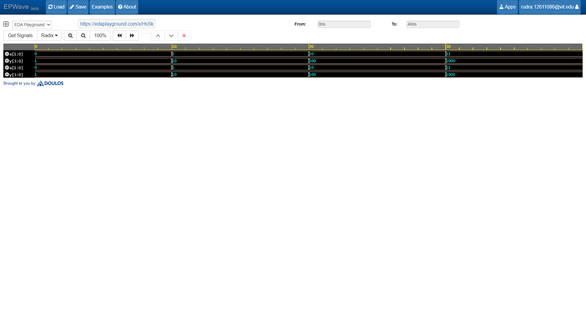

# 2-to-4 Decoder

## 📝 Description
A **2-to-4 Decoder** is a combinational logic circuit that converts a $n$-bit binary input code into $2^n$ unique output lines. For a 2-bit input (`a[1:0]`), it activates exactly one of the four output lines (`y[3:0]`) while keeping the remaining outputs low, depending on the binary value of the input.

## 📊 Truth Table

| Input `a[1]` | Input `a[0]` | Output Vector `y[3:0]` | Active Output Line |
| :---: | :---: | :---: | :---: |
| 0 | 0 | `0001` | `y[0]` |
| 0 | 1 | `0010` | `y[1]` |
| 1 | 0 | `0100` | `y[2]` |
| 1 | 1 | `1000` | `y[3]` |

## 🛠️ Tools Used
* **Language:** Verilog HDL
* **Simulation Platform:** [EDA Playground](https://edaplayground.com/)
* **Simulator:** Cadence Xcelium / Icarus Verilog
* **Waveform Viewer:** EPWave

## 🚀 Simulation Waveform

