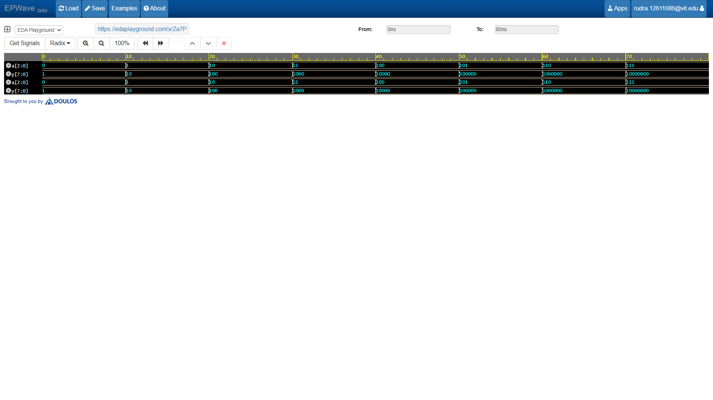

# 3-to-8 Decoder

## 📝 Description
A **3-to-8 Decoder** is a combinational logic circuit that takes a 3-bit binary input vector (`a[2:0]`) and decodes it to assert exactly one of eight mutually exclusive output lines (`y[7:0]`). The unselected outputs remain low. Decoders are fundamental hardware blocks heavily utilized in memory address decoding, instruction decoding, and data routing architectures.

## 📊 Truth Table

| Input `a[2]` | Input `a[1]` | Input `a[0]` | Output Vector `y[7:0]` | Active Output Line |
| :---: | :---: | :---: | :---: | :---: |
| 0 | 0 | 0 | `00000001` | `y[0]` |
| 0 | 0 | 1 | `00000010` | `y[1]` |
| 0 | 1 | 0 | `00000100` | `y[2]` |
| 0 | 1 | 1 | `00001000` | `y[3]` |
| 1 | 0 | 0 | `00010000` | `y[4]` |
| 1 | 0 | 1 | `00100000` | `y[5]` |
| 1 | 1 | 0 | `01000000` | `y[6]` |
| 1 | 1 | 1 | `10000000` | `y[7]` |

## 🛠️ Tools Used
* **Language:** Verilog HDL
* **Simulation Platform:** [EDA Playground](https://edaplayground.com/)
* **Simulator:** Cadence Xcelium / Icarus Verilog
* **Waveform Viewer:** EPWave

## 🚀 Simulation Waveform

