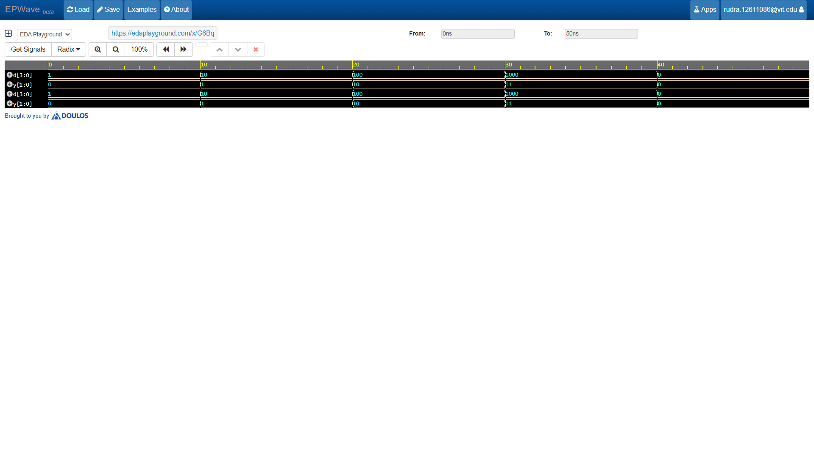

# 4-to-2 Priority Encoder

## Overview
This project implements a **4-to-2 Priority Encoder** in Verilog HDL. An encoder compresses $2^n$ input lines into an $n$-bit binary code. A priority encoder resolves conflicting input signals by assigning a priority level to each input (with higher-order bits taking precedence), ensuring correct behavior when multiple input lines are asserted simultaneously.

## Features
* **Priority Resolution:** Automatically encodes the highest-order active input when multiple input lines are active.
* **Valid Indicator (`valid`):** Includes a status flag to distinguish between an encoded zero input and an unasserted state.
* **Simulation Ready:** Fully verified with a comprehensive testbench covering single-bit assertions and overlapping priority cases.

## Truth Table (Priority-Based)

| $I_3$ | $I_2$ | $I_1$ | $I_0$ | $Y_1$ | $Y_0$ |
| :---: | :---: | :---: | :---: | :---: | :---: |
| 0 | 0 | 0 | 1 | 0 | 0 |
| 0 | 0 | 1 | 0 | 0 | 1 |
| 0 | 1 | 0 | 0 | 1 | 0 |
| 1 | 0 | 0 | 0 | 1 | 1 |

*(Note: Unselected bits within the output vector default to `0` to prevent latches.)*

## 🛠️ Tools Used
* **Language:** Verilog HDL
* **Simulation Platform:** [EDA Playground](https://edaplayground.com/x/G6Bq)
* **Simulator:** Cadence Xcelium / Icarus Verilog
* **Waveform Viewer:** EPWave

## 🚀 Simulation Waveform

