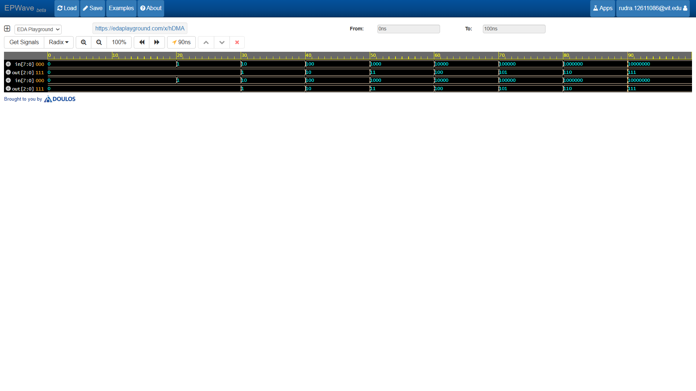

# 8-to-3 Encoder

## Overview
This project implements a basic **8-to-3 Binary Encoder** in Verilog HDL. An encoder performs the inverse operation of a decoder, compressing $2^n$ input lines into an $n$-bit binary code. In this standard 8-to-3 encoder design, a one-hot active input vector is mapped directly to its corresponding 3-bit binary representation.

## Features
* **Combinational Design:** Built using a clean `always @(*)` procedural block and `case` statements.
* **One-Hot Mapping:** Translates individual active-high input lines ($I_0$ through $I_7$) into 3-bit binary outputs ($000$ to $111$).
* **Simulation Ready:** Verified using a comprehensive testbench covering all individual input combinations.

## Truth Table

| $I_7$ | $I_6$ | $I_5$ | $I_4$ | $I_3$ | $I_2$ | $I_1$ | $I_0$ | $Y_2$ | $Y_1$ | $Y_0$ |
| :---: | :---: | :---: | :---: | :---: | :---: | :---: | :---: | :---: | :---: | :---: |
| 0 | 0 | 0 | 0 | 0 | 0 | 0 | 1 | 0 | 0 | 0 |
| 0 | 0 | 0 | 0 | 0 | 0 | 1 | 0 | 0 | 0 | 1 |
| 0 | 0 | 0 | 0 | 0 | 1 | 0 | 0 | 0 | 1 | 0 |
| 0 | 0 | 0 | 0 | 1 | 0 | 0 | 0 | 0 | 1 | 1 |
| 0 | 0 | 0 | 1 | 0 | 0 | 0 | 0 | 1 | 0 | 0 |
| 0 | 0 | 1 | 0 | 0 | 0 | 0 | 0 | 1 | 0 | 1 |
| 0 | 1 | 0 | 0 | 0 | 0 | 0 | 0 | 1 | 1 | 0 |
| 1 | 0 | 0 | 0 | 0 | 0 | 0 | 0 | 1 | 1 | 1 |

## Waveform Simulation

