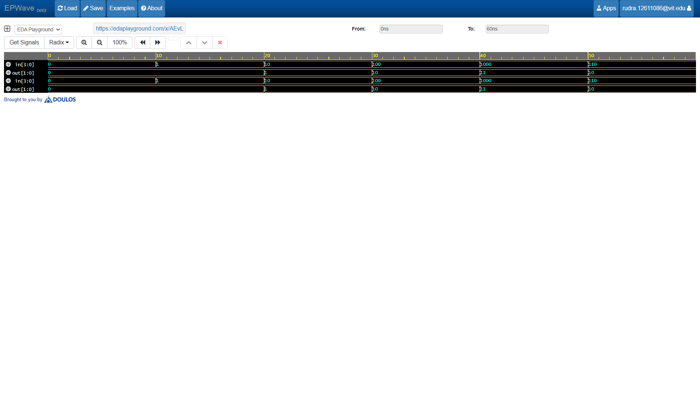

# 4-to-2 Priority Encoder (Verilog HDL)

A clean and efficient implementation of a **4-to-2 Priority Encoder** written in SystemVerilog, complete with a testbench and simulation waveforms. Designed for digital logic learning and hardware verification.

---

## 🛠️ Circuit Overview
A priority encoder resolves multiple active inputs by assigning a priority level to each input line. In this design, the highest-order input (`d[3]`) has the highest priority, while the lowest-order input (`d[0]`) has the lowest priority.

### Truth Table
| Input ($d_3 d_2 d_1 d_0$) | Outputs ($y_1 y_0$) | `valid` | Description |
| :---: | :---: | :---: | :--- |
| `0000` | `00` | `0` | No active input |
| `---1` | `00` | `1` | $d[0]$ active |
| `--1x` | `01` | `1` | $d[1]$ active |
| `-1xx` | `10` | `1` | $d[2]$ active |
| `1xxx` | `11` | `1` | $d[3]$ active (Highest Priority) |

---

## 📂 Repository Files
- **`design.sv`**: SystemVerilog behavioral description of the 4-to-2 priority encoder using `always_comb` and conditional `if-else` prioritization.
- **`testbench.sv`**: Testbench applying various single and simultaneous active inputs to verify priority logic.
- **`waveform.png`**: Simulation waveform captured via EPWave verifying correct behavioral execution.

---

## Waveform Simulation

