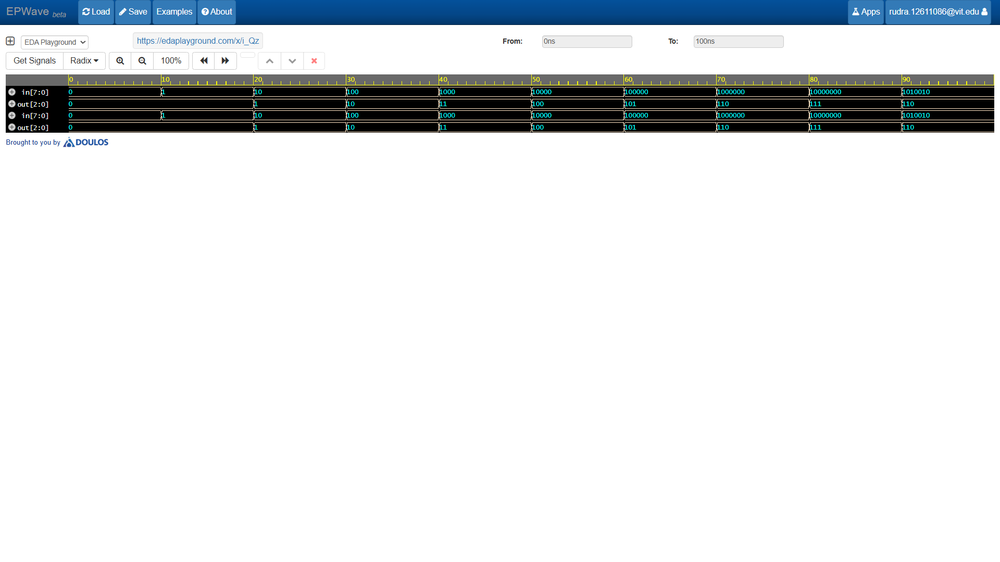

# 8-to-3 Priority Encoder (Verilog HDL)

A robust and efficient implementation of an **8-to-3 Priority Encoder** written in SystemVerilog, complete with a testbench and simulation waveforms for digital logic verification.

---

## 🛠️ Circuit Overview
A priority encoder resolves multiple active input lines by assigning a strict priority hierarchy. In this 8-to-3 design, input bit `in[7]` carries the highest priority, while `in[0]` carries the lowest priority.

### Truth Table Summary
| Input (`in[7:0]`) | Output (`out[2:0]`) | Description |
| :---: | :---: | :--- |
| `00000000` | `000` | No active input |
| `-------1` | `000` | `in[0]` active |
| `------1x` | `001` | `in[1]` active |
| `-----1xx` | `010` | `in[2]` active |
| `----1xxx` | `011` | `in[3]` active |
| `---1xxxx` | `100` | `in[4]` active |
| `--1xxxxx` | `101` | `in[5]` active |
| `-1xxxxxx` | `110` | `in[6]` active |
| `1xxxxxxx` | `111` | `in[7]` active (Highest Priority) |

---

## 📂 Repository Files
- **`design.sv`**: SystemVerilog behavioral description utilizing `always_comb` and conditional `if-else` branching for priority resolution.
- **`testbench.sv`**: Comprehensive testbench verifying single inputs, overlapping active bits, and edge cases.
- **`dump.vcd`**: VCD waveform output for visual debugging via EPWave.

---

## 🚀 Waveform Simulation

