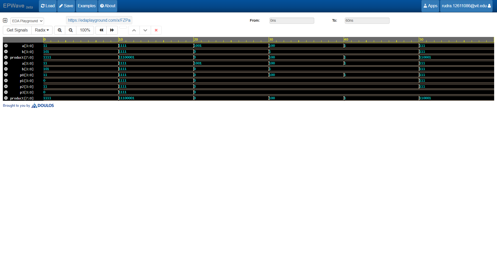

# 4x4 Binary Array Multiplier

## 📋 Overview
A combinational 4-bit by 4-bit binary multiplier implemented in Verilog. This circuit performs multiplication by generating intermediate partial products using bitwise operations and accumulating them through shifted addition, mimicking manual long multiplication in digital hardware.

---

## ⚙️ Working Principle
When multiplying two 4-bit numbers $A$ and $B$:
1. **Partial Product Generation:** Each bit of multiplier $B$ is ANDed with multiplicand $A$ to produce four partial products ($p_0, p_1, p_2, p_3$).
2. **Shift & Accumulate:** Each successive partial product is shifted left according to its bit weight and summed to yield the final 8-bit product:
   $$\text{Product} = p_0 + (p_1 \ll 1) + (p_2 \ll 2) + (p_3 \ll 3)$$

---

## Waveform Simulation

